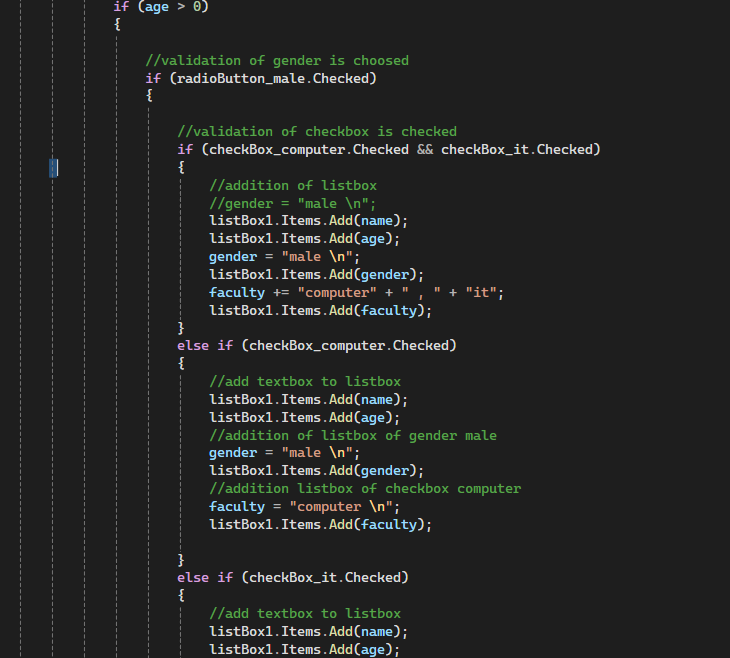
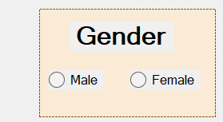
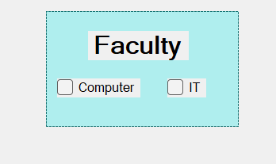

## this readme demonstrates the explanation of the codes which are in the screenshots.

## 

< This section demonstrates how to use if-else statements in C# Windows Forms to check whether a user has selected an item from a ListBox control>.

In this example, the program checks the selected item and displays the appropriate message.

* SelectedIndex: Checks whether an item has been selected in the ListBox. A value of -1 means that no item is selected.
* selection: A string variable that stores the text of the selected item.
* SelectedItem: Retrieves the item selected by the user from the ListBox.
* ToString(): Converts the selected item into a string.
* MessageBox.Show(): Displays the selected item or a message to the user.

# How It Works

1. The program checks whether the user has selected an item from the ListBox using the SelectedIndex property.
2. If an item is selected, the program retrieves the selected item’s text and stores it in the selection variable.
3. The program displays the selected item using MessageBox.Show().
4. If no item is selected, the else statement executes and displays a message asking the user to select an item.
5. This process helps ensure that the program checks the user’s selection before processing the item.

## 

< Nested If Statements in C# Windows Forms

This section demonstrates how to use nested if statements in C# Windows Forms to validate user information and add the entered data to a ListBox based on selected options.

In this example, the program checks the user’s age, selected gender, and computer-related checkbox options before adding information to the ListBox.

* Nested If: An if statement placed inside another if statement to check multiple conditions.
* Age: Used to validate the user’s age before processing the information.
* RadioButton_male.Checked: Checks whether the male RadioButton has been selected.
* CheckBox_computer.Checked: Checks whether the computer checkbox has been selected.
* ListBox1.Items.Add(): Adds information, such as the user’s name, age, gender, or faculty, to the ListBox.
* Else If: Checks another condition when the preceding if condition is false.
* Gender: Stores the selected gender information.
* Faculty: Stores the selected faculty information, such as computer studies.

# How It Works

1. The program first checks whether the user’s age satisfies the specified condition.
2. If the age condition is true, the program checks whether the male RadioButton has been selected.
3. Inside that condition, another if statement checks whether the computer checkbox is selected.
4. If both the gender and computer checkbox conditions are true, the program adds the user’s name, age, gender, and faculty to the ListBox.
5. If the computer checkbox condition is false, the program checks other conditions using else-if statements.
6. The program adds the appropriate information to the ListBox according to the conditions that are satisfied.
7. This process demonstrates how nested if statements and else-if statements can be used to validate information and control program execution.

# Important Points

* A nested if is an if statement placed inside another if statement.
* Nested if statements allow a program to check multiple related conditions.
* The Checked property determines whether a RadioButton or CheckBox is selected.
* The Items.Add() method adds an item to a ListBox.
* An else-if statement allows the program to check alternative conditions.
* The order of conditions determines which block of code executes.
* Nested if statements are useful when an action depends on more than one condition.

All the concepts listed above are the concepts demonstrated in this nested-if example.

## 

< RadioButton in C# Windows Forms>

This section demonstrates how to use RadioButton controls in C# Windows Forms to allow users to select one option from a group of choices.

In this example, RadioButton controls can be used to represent different options, such as male and female, allowing the user to choose the appropriate option.

* RadioButton: A Windows Forms control that allows users to select one option from a group of mutually exclusive choices.
* Checked Property: Indicates whether a RadioButton has been selected.
* Group of RadioButtons: RadioButtons in the same group allow the user to select only one option at a time.
* Selection: The selected RadioButton represents the option chosen by the user.

# How It Works

1. The application displays RadioButton controls representing different options.
2. The user selects one of the available RadioButtons.
3. The Checked property determines which RadioButton has been selected.
4. When the user selects another RadioButton in the same group, the previous selection is automatically cleared.
5. The program can use the selected option to process information or determine the next action.

# Important Points

* RadioButtons are used when the user must choose one option from a group.
* The Checked property indicates whether a RadioButton is selected.
* Only one RadioButton can be selected at a time within the same group.
* RadioButtons are commonly used for gender selection, payment methods, and other single-choice options.
* GroupBox controls can be used to organize RadioButtons into separate groups.

All the concepts listed above explain the use of RadioButton controls in C# Windows Forms.

## 

CheckBox in C# Windows Forms

This section demonstrates how to use CheckBox controls in C# Windows Forms to allow users to select different options in an application.

In this example, two CheckBox controls are displayed under the Faculty section:

* Computer: Allows the user to select Computer as a faculty option.
* IT: Allows the user to select Information Technology as a faculty option.

The Checked property is used to determine whether a CheckBox has been selected.

# How It Works

1. The application displays two CheckBox controls labeled Computer and IT.
2. The user selects the desired option by clicking the corresponding checkbox.
3. The program checks the Checked property to determine whether each option is selected.
4. The user can select both Computer and IT, only one option, or neither option.
5. The selected options can then be used for further processing, such as displaying or storing the user’s choices.

# Important Points

* A CheckBox is a Windows Forms control that allows users to select or deselect an option.
* The Checked property indicates whether a checkbox is selected.
* Multiple CheckBox controls can be selected at the same time.
* CheckBox controls are useful when users are allowed to choose more than one option.
* CheckBox controls can be used with if statements to check the user’s selections and perform specific actions.

All the concepts listed above are the concepts covered in this example.

## 

< ListBox in C# Windows Forms>

This section demonstrates how to use a ListBox control in C# Windows Forms to display and manage a collection of items in an application.

In this example, a ListBox is used to display information such as a user’s name, age, gender, and faculty.

* ListBox: A Windows Forms control that displays a list of items from which users can select.
* Items.Add(): Adds a new item to the ListBox.
* SelectedItem: Retrieves the item currently selected by the user.
* SelectedIndex: Returns the index of the selected item. A value of -1 means that no item is selected.
* Items.Remove(): Removes a specified item from the ListBox.
* Items.RemoveAt(): Removes an item from the ListBox using its index.
* Items.Clear(): Removes all items from the ListBox.
* ToString(): Converts an item into its string representation.

# How It Works

1. The application displays a ListBox that can contain multiple items.
2. Items can be added to the ListBox using the Items.Add() method.
3. The user can select an item from the displayed list.
4. The SelectedItem property retrieves the selected item, while SelectedIndex identifies its position in the list.
5. The program can remove a selected item using the appropriate removal method.
6. The Items.Clear() method can be used to remove all items from the ListBox.
7. The ListBox allows the program to display and manage information entered by the user.

# Important Points

* A ListBox displays a collection of items in a list.
* The Items collection stores the items displayed in the ListBox.
* The Add() method adds items to the list.
* The SelectedItem property retrieves the selected item.
* The SelectedIndex property identifies the selected item’s position.
* The Remove() method removes a specified item.
* The RemoveAt() method removes an item using its index.
* The Clear() method removes all items from the list.
* Checking whether an item is selected before processing or deleting it helps prevent errors.

All the concepts listed above explain the use of ListBox controls in C# Windows Forms.

