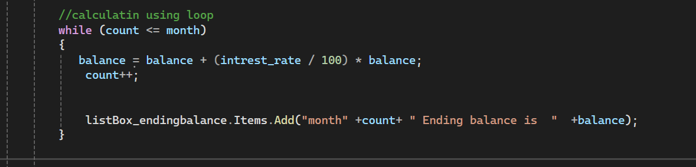
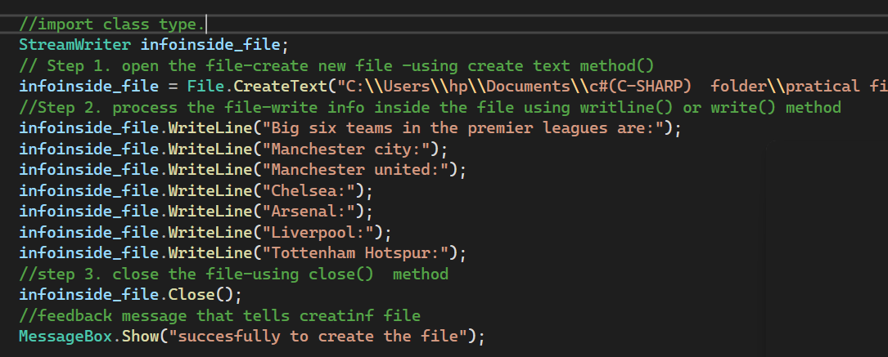

## this readme demonstrates the explanation of the codes which are in the screenshots.

## 

< While Loop Example in C#>

This section demonstrates how to use a while loop in C# Windows Forms to repeat a block of statements as long as a specified condition is true.

In this example, a while loop is used to execute statements repeatedly until the condition becomes false.

* while loop: Repeats a block of statements while the specified condition is true.
* Condition: Determines whether the loop should continue executing.
* Counter variable: Keeps track of the number of times the loop executes.
* Increment: Increases the counter variable to control the number of iterations.

# How It Works

1. The program initializes the counter variable with a starting value.
2. The while loop checks whether the specified condition is true.
3. If the condition is true, the statements inside the loop are executed.
4. The counter variable is updated after each iteration.
5. The loop checks the condition again and continues executing while the condition remains true.
6. When the condition becomes false, the loop terminates.

This example demonstrates how a while loop can be used to repeat operations and control program execution in C#.

## 

< Creating a File in C# Windows Forms> 

This section demonstrates how to create a text file in C# Windows Forms to store information for later use.

In this example, the File.CreateText() method is used to create a text file, while the StreamWriter class is used to write data into the file.

* File.CreateText(): Creates a new text file or overwrites the contents of an existing file.
* StreamWriter: A class used to write text data to a file.
* WriteLine(): Writes data to a file and moves to the next line.
* Write(): Writes data to a file without moving to the next line.
* Close(): Closes the file after writing is complete.
* File Path: Specifies the location and name of the file being created.

# How It Works

1. The program creates a StreamWriter object using the File.CreateText() method.
2. The method creates a new text file at the specified location.
3. The program writes information into the file using the WriteLine() or Write() method.
4. The WriteLine() method places each new piece of information on a separate line.
5. After writing the required information, the program closes the file using the Close() method.
6. The created file stores the information so it can be accessed later.

# Important Points

* File.CreateText() creates a text file if it does not exist.
* If the specified file already exists, File.CreateText() overwrites its existing contents.
* StreamWriter is used to write text into a file.
* WriteLine() adds a new line after writing data.
* Write() writes data without automatically adding a new line.
* Closing the file helps ensure that written data is properly saved and file resources are released.
* The specified file path determines where the file is stored.

All the concepts listed above explain how to create and write data to a text file in C#.